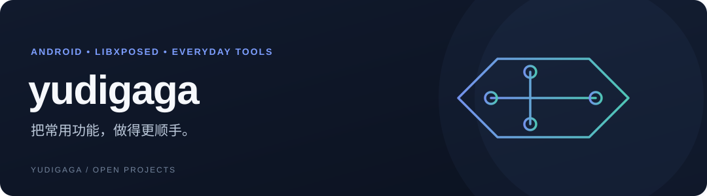

  

# Hi, I'm yudigaga

折腾 Android，把常用功能做得更顺手。

主要在做应用增强、系统界面和跨应用工具，项目集中在 **Android / libxposed / MIUI / HyperOS**。

## 正在维护

| 项目 | 做什么 | 入口 |
| --- | --- | --- |
| **[DouAi](https://github.com/yudigaga/DouAi)** | 抖音增强：播放、内容筛选、下载、AI 与本地分析 | [下载](https://github.com/yudigaga/DouAi/releases) |
| **[FusionStatusBar](https://github.com/yudigaga/FusionStatusBar)** | MIUI / HyperOS 的状态栏、控制中心与系统交互设置 | [下载](https://github.com/yudigaga/FusionStatusBar/releases) |
| **[TaplusBridge](https://github.com/yudigaga/TaplusBridge)** | 传送门增强：长按识别、四向拖动与链接流转 | [下载](https://github.com/yudigaga/TaplusBridge/releases) |
| **[IceBridge](https://github.com/yudigaga/IceBridge)** | 冻结应用解冻、规则路由与跨应用链接桥接 | [下载](https://github.com/yudigaga/IceBridge/releases) |
| **[TokAi](https://github.com/yudigaga/TokAi)** | TikTok 的界面、播放、内容和媒体工具增强 | [下载](https://github.com/yudigaga/TokAi/releases) |

> 安装前请阅读对应项目的环境与适配说明。最低 Android 版本不代表所有 ROM、宿主版本和设备均已验证。

## 还在探索

- [GestureEVO](https://github.com/yudigaga/GestureEVO)：Android 手势与快捷操作工具，基于 [LumiaGG/GestureEVO](https://github.com/LumiaGG/GestureEVO) 的分支。
- [audio-converter](https://github.com/yudigaga/audio-converter)：在线音频转换工具。

## 技术与记录

Java · Kotlin · Android · libxposed · Compose / Miuix

使用说明、构建方式、版本记录与验证边界放在各项目的 README 和文档目录里。问题反馈请前往对应仓库的 Issues，并附上版本、环境和复现步骤。

[全部公开项目](https://github.com/yudigaga?tab=repositories&type=source)
